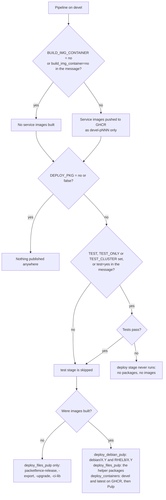

# Pipeline variables on `devel`

What each CI variable does once `feature/pulp-pipeline-repositories` is merged into `devel`, and
what it changes about what a pipeline publishes. Set them under *Run pipeline* in the GitLab UI, as
project variables, or — for most of them — with a word in the commit message.

## How a switch is wired

GitLab reads a job's `rules:` top to bottom and the **first match wins**; a rule with `when: never`
drops the job from the pipeline entirely. The switches come in three shapes:

| Shape | Written as | Default | Example |
|---|---|---|---|
| Kill switch | `$X == "no"` → `when: never`, placed first | on | `BUILD_IMG_CONTAINER`, `DEPLOY_PKG` |
| Opt-in | `$X != "yes"` → `when: never` | off | `BUILD_PF_IMG_ZEN`, `BUILD_ARTIFACTS_DOC` |
| Context arm | ref + `$CI_PIPELINE_SOURCE` | — | `.deploy_pkg_rules`, `.test_rules` |

An unset variable is empty, so an opt-in is off until you set it. The shared fragments live at the
top of `.gitlab-ci.yml` as `.gated_by_*` and are pulled in with `!reference`, so a switch has one
definition and every job that honours it reads the same condition.

## What a `devel` pipeline publishes

The invariant the graph encodes: **PacketFence packages and the branch image tags are published by
the same pipeline, or by neither.** `deploy_debian_pulp` and `deploy_containers` carry the same two
gates and the same context arms, and both sit in the `deploy` stage with no `needs:`, so a failing
test blocks them together. The only package job that can publish alone is `deploy_files_pulp`, whose
four packages carry no container reference.

## Publishing switches

| Variable | Values | Default | What it gates | Consequence |
|---|---|---|---|---|
| `DEPLOY_PKG` | `no`, `false` | unset = deploy | `deploy_debian_pulp`, `deploy_files_pulp`, `deploy_containers`, `deploy_branches_pulp` | `no` publishes nothing to Pulp. The pipeline still builds, signs and tests. |
| `PUBLISH_PPA` | `yes`, `true` | unset | alias of `DEPLOY_PKG` for feature branches; also forces `publish_ppa` | On a feature branch, `yes` is what makes it deploy at all. |
| `BUILD_IMG_CONTAINER` | `no` | unset = build | every service image job, `deploy_containers`, **and `deploy_debian_pulp`** | `no` skips the images *and* the packages, so a server can never install packages built against the previous pipeline's containers. The helper packages still publish. |
| `BUILD_ARTIFACTS_PKG` | `no` | unset = build | `publish_ppa` and the package builds | `no` leaves the pipeline with nothing to sign or publish. |

Commit-message equivalents: `build_img_container=no`, `deploy_pkg=yes|true`, `publish_ppa=yes|true`.

## Test switches

| Variable | Values | Default | Effect |
|---|---|---|---|
| `TEST` | `yes` | unset | Runs the `test` stage. On `devel` any non-schedule pipeline qualifies; `maintenance/X.Y` needs web/api/schedule. |
| `TEST_ONLY` | `grep -E` pattern | `""` | Runs only the matching test jobs (`ci/lib/test/test-only-matches.sh`). A non-empty value counts as "tests requested" in every rule that checks `$TEST_ONLY != ""`. Filtering happens in the shell, not in the rules, so the jobs still start. |
| `TEST_CLUSTER` | `yes`, `no` | `""` | `yes` forces the 3-VM cluster tests on their own; `no` opts out even when `TEST=yes`. |
| `KEEP_VMS` | `yes` | `no` | Keeps the test VMs, but only when `TEST_ONLY` selects that job — otherwise it is downgraded with a warning. |

Message equivalents: `test=yes`, `test_cluster=yes`, `test_cluster=no`.

Consequence to keep in mind: requesting tests does **not** change *what* gets published, only whether
the pipeline is allowed to get there. No tests → publish. Tests green → publish. Tests red → nothing.

## Build opt-ins

All default to off and need the value `yes` (or the message word):

| Variable | Message word | Builds |
|---|---|---|
| `BUILD_IMG_DOCKER` | `build_img_docker=yes` | the toolchain images (`pfbuild-*`, `signing-packages`, `publish-ppa`) |
| `BUILD_IMG_VAGRANT` | `build_img_vagrant=yes` | the Vagrant box used by the tests |
| `BUILD_PF_IMG_ZEN` | `build_pf_img_zen=yes` | the ZEN appliance image |
| `BUILD_PF_IMG_CD_ISO` | `build_pf_img_cd_iso=yes` | the CD ISO |
| `BUILD_PF_IMG_DVD_USB_ISO` | `build_pf_img_dvd_usb_iso=yes` | the offline DVD/USB ISO; also forces `publish_ppa` |
| `BUILD_PF_IMG_VAGRANT` | `build_pf_img_vagrant=yes` | the released Vagrant box |
| `BUILD_ARTIFACTS_DOC` | `build_artifacts_doc=yes` | the guides, and lets `deploy_docs_pulp` publish them |
| `BUILD_ARTIFACTS_MATERIAL` | `build_artifacts_material=yes` | the pfconfig material |
| `GO_CHECK` | — | Go analysis and the full Go build on both build images |
| `BUILD_PFAPPSERVER_VUE` | — | the Vue UI; `yes` by default, set `no` to skip it |

## Configuration, not switches

| Variable | Default | Notes |
|---|---|---|
| `PF_PACKAGE_ORIGIN` | `https://packages.packetfence.com` | Pulp origin for packages, images and docs. Must be a bare HTTPS origin. |
| `PSONO_CI_PULP_PACKAGES_ID` / `_DOCKER_ID` / `_DOCS_ID` | `""` | Psono entries for the `ci-packages`, `ci-docker`, `ci-docs` accounts. Set them as **protected** variables; the Pulp jobs fail while they are empty. |
| `IMAGE_TAG` | `$CI_COMMIT_REF_SLUG` | Overridden per context; `latest` on `devel`. |
| `CLUSTER_RUNNER_TAG` | `test-cluster-shell-v7` | Runner tag for the cluster tests. |

## Common runs on `devel`

| You run | Tests | Packages | Images |
|---|---|---|---|
| plain push | skipped | published | `devel-p<id>` promoted to `devel,latest`, then Pulp |
| push with `test=yes`, green | run | published | promoted |
| push with `test=yes`, red | run | **not** published | **not** promoted |
| `TEST_ONLY=configurator`, green | that job only | published | promoted |
| `DEPLOY_PKG=no` | per the other switches | nothing | nothing |
| `BUILD_IMG_CONTAINER=no` | per the other switches | helper packages only | none built or pushed |
| release tag `vX.Y.Z` | — | nothing: the packages came from `maintenance/X.Y` | images stay on GHCR as `vX.Y.Z`, nothing pushed to Pulp |

A `vX.Y.Z` tag is the one case where a deploy job still runs: `deploy_docs_pulp` publishes the guides
to `doc/X.Y.0`. `check_pulp_release` runs first and stops the pipeline unless the tag matches
`conf/pf-release` and Pulp already has that version's repositories.

## Why the images carry a pipeline tag

On `devel` the service images are pushed to GHCR only as `<slug>-p<pipeline>`
(`ci/lib/common/pipeline-image-tag.sh`), never under the branch tag at build time. The test VMs pull
exactly that tag — provisioning writes `/etc/packetfence-ci-image-tag`
(`addons/vagrant/playbooks/install_pf.yml`) and `manage-images.sh` retags locally — so the tests
exercise the images their own pipeline built, not whatever last landed on `devel`. `deploy_containers`
then copies those manifests onto the branch tags. The `maintenance/X.Y` branches do not use this: they
build straight to GHCR as `maintenance-X-Y` and `deploy_containers` only mirrors GHCR to Pulp.

See `ci/pulp/README.md` for what each deploy job writes into Pulp.
